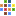

# Bongo Matrix



A Raspberry Pi and a 64×32 HUB75 RGB LED panel, turned into a modular display.

This version (the project's third iteration, internally "v3") is a ground-up rewrite. Everything up to v2 is frozen on the
[`archive/v2`](../../tree/archive/v2) branch. The guiding rule for v3 is
**modularity with as little code as possible**: the core knows how to play a
playlist, and every screen lives in its own folder under `bongo/modules/`.

Licence: MIT, see [LICENSE.md](LICENSE.md).

## How it fits together

```
bongo/
  module.py      the contract: Module, Style, Context
  registry.py    finds every folder in bongo/modules/ that exposes MODULE
  player.py      plays a playlist of (module, style, settings, seconds)
  panel.py       HardwarePanel (rgbmatrix) and RecordingPanel (previews, tests)
  fonts.py       pixel-exact BDF fonts from resources/fonts
  config.py      data/config.json: panel, timezone, playlist
  safe_area.py   margins for a frame that hides the panel edges
  schedule.py    splash, sleep hours and brightness
  daylight.py    Follow daylight: the brightness through the day from the sun at the Matrix's location
  schema.py      setting types inferred from defaults, for validation and the dashboard
  media.py       the media library: built-in/ (shipped) and uploaded/ (from the dashboard)
  holidays.py    offline holiday rules (Easter, bank holidays, "last Monday in May")
  live.py        what's on now, shared between the player and the dashboard
  panelpreview.py  the editor's unsaved draft held on the panel for a while (Preview on the panel)
  web/           the dashboard: JSON API + a small single-page app (pair with a PIN)
  modules/       one folder per screen (table below)
```

A **module** is one idea (a clock, the weather). A **style** is one look of that
module. Styles share the module's settings (time format, alignment) and add
their own. Picking a style is just a playlist setting:

```json
{"module": "clock", "style": "lava_metro", "seconds": 30, "settings": {"palettes": ["ocean"]}}
```

A playlist entry can also be given times of day (in the dashboard: its Timing card, **When it plays**):

```json
{"module": "weather", "seconds": 20, "times": [{"from": "08:00", "to": "10:00"}, {"from": "20:00", "to": "22:00"}]}
```

It then plays only inside them (up to 4; `"from"` after `"to"` runs past midnight; left out, it plays all
day). The one on the panel finishes its seconds, the sleep hours still win, and if nothing is set to play
the panel is blank until something is. The dashboard warns about such a gap before you apply it.

See [docs/MODULES.md](docs/MODULES.md) to write a module and
[docs/NETWORK.md](docs/NETWORK.md) for how Matrices find each other and share their version.

## Modules

| Module | Styles | What it shows |
| --- | --- | --- |
| Clock | lava_classic, lava_metro, big, flip, seven, nixie, nixie_seconds, word_grid, word_lines, dial, minimal, binary, pet, tree | Every clock face in one place, in groups. **Lava**: time and date over moving wax; lava_classic is the v2 look (outlined, blurred blobs, 27 palettes). Metro is the refresh: wax that rises and sinks with a soft glow and hot core, clean type, 5 gradient palettes (magma, ocean, aurora, synthwave, mono). **Digital**: big, split-flap and seven-segment. **Glass tube**: nixie tubes. **Word**: a letter grid or typed-in lines ("twenty five past seven"). **Analogue**: a dial and a minimal wide face. **Binary**: BCD dots. **Pet**: a clock your pet visits now and then (walks by, naps on it, bats a ball, sits on the colon). **Seasonal tree**: an apple tree (or an oak) between the hour and the minutes that comes into leaf, blossoms, fruits and drops its leaves day by day (Northern or Southern hemisphere), takes its weather from the last OpenWeather reading a Weather screen fetched, and is visited by a robin, butterflies (five kinds: alone, chasing each other in pairs, settling on a flower, or a few dancing together) and fireflies; every picture is an Animator drawing (`tree_apple`, `tree_oak`, `tree_robin`...). 12 or 24 hours. Old `lava_lamp` playlist entries become `clock/lava_*` on their own. |
| Ambient | digital_rain, starfield, fire, plasma, rain_on_glass, aurora, fireflies, ocean, snow, life, sand, starlings, maze, pipes | Calm moving pictures with nothing to read, grouped Retro, Sky, Weather and Patterns. Each is a small simulation that fills the safe area; `speed` (0.25-4) sets the pace. Snow melts, sand drains, mazes and pipes start again on their own. |
| QR code | standard, wifi_guests, call_or_text, two_codes, code_only, code_and_message (+ `corner` overlay) | A real scannable code, one LED per module, with a label and the address scrolling underneath: a link, guest Wi-Fi (joins without typing), a number to call or text, two links side by side, a bigger code alone (about 50 characters), or swapping with a big message. Links too long to fit are refused on save with how much to cut. |
| Spotify | cover, backdrop, vinyl (+ `ticker` overlay) | What's playing: the cover, title and artist (scrolling when long), time and progress in the cover's colour. Greys out when paused and hands over to the next screen after a while, or at once when nothing plays. Sign in once in Settings > Spotify with your own Spotify app's Client ID (Development Mode; the app owner needs Premium). |
| Weather | overview, ticker, forecast, days, classic | Current conditions, high/low, the next few 3-hour slots and the next few days from OpenWeather (free API key, Settings > Weather; opens on their credit). |
| Text | static, scroll | Your own message, centred or scrolling. |
| Media | fit, fill, pixel | Images, animated GIFs and short videos (first 15 s, needs `ffmpeg`) from the media library; `pixel` scales pixel art crisply. |
| Announcements | banner, card, flash | Notices scheduled by date, weekday and hour; several rotate. |
| News | ticker, headline, picture | Headlines from RSS/Atom feeds, newest first; `picture` shows the story's thumbnail beside it. A feed must be an http(s) address that really serves RSS or Atom; the dashboard checks new feeds when you save. Each feed can have word filters: only stories that mention, and never show stories that mention, the words or phrases you list. |
| Calendar | Today: page, desk, date_line, week · Month: month, numbers, dots, year · Progress: progress, rings, weeks, percent · Countdown: countdown_days, countdown_clock, countdown_flip, countdown_ring, countdown_tearoff | One list of your dates (once, every year or a holiday; time, message, icon, colour) shown on the calendar looks; the countdowns count down to the soonest (or, with none, the next ticked holiday). The Countdown module moved in on 12 Nov 2026: saved entries move over by themselves. |
| Pet | life, idle, eating, napping, playing, zoomies, … | Mochi the cat, or one of the other animals, in her home. Life plays the ticked modes through the day; the `wander` overlay walks her across other screens. Pick her and name her on the Pet page (Settings > Modules > Pet). |
| Sky | moon, sun | Moon phase and next full/new moon; today's sun arc with sunrise and sunset. |

## Try it without a panel

```bash
python3 -m venv venv && ./venv/bin/pip install -r requirements.txt
./venv/bin/python -m bongo list
./venv/bin/python -m bongo preview clock --style lava_metro --out metro.gif
./venv/bin/python -m bongo preview clock --style lava_classic --set 'palettes=["fire_burst"]'
```

Previews are LED-look GIFs rendered by exactly the code that drives the panel.

## Run it on the Pi

1. Install [hzeller/rpi-rgb-led-matrix](https://github.com/hzeller/rpi-rgb-led-matrix)
   and its Python bindings so the venv's Python can `import rgbmatrix`.
   That driver is a separate program under the GPL-2.0 licence and is not part of this
   repository, which is MIT. Bongo Matrix only loads it when it runs on a panel; the previews
   and the tests never need it. Anyone who passes on a device or image that has the driver built
   in has to include the driver's licence and offer its source, as its licence says.
2. For video in the Media module: `sudo apt install ffmpeg`.
3. Copy `config.example.json` to `data/config.json` and edit the playlist.
   An empty playlist plays every module in its default style.
4. `sudo ./venv/bin/python -m bongo run`, or install `deploy/bongo-matrix.service`.

A display needs only the public build on GitHub: the code without tests, tools, the roadmap or the dashboard
demo. Install it as a git checkout:

```bash
git clone -b main https://github.com/SpaceWaffle42/BongoMatrix /home/admin/matrix
```

### Wi-Fi and finding it

No keyboard or SSH needed: a Matrix with no Wi-Fi it knows opens a `Matrix-Setup-XXXX` network
(the panel shows its password and a join code), and a phone that joins gets the setup page. Once
on Wi-Fi it answers at `http://<its name>.local`, shows its address on the panel when that changes,
and every Matrix on the network is listed at `http://matrix.local`. See
[docs/NETWORK.md](docs/NETWORK.md), including what to test on a real Pi.

### Updates

The public version number is kept in `bongo/__init__.py` and bumped by hand at a release (there is no automated release process). A Matrix that updates from any branch other than `main` adds the branch to the number it shows: `v1.0.0.cat_tree`. Builds from before the public numbering stamped `3.x`; those count as older than `1.0.0`. An older hub (the 3.x numbering) therefore sees v1 Matrices as older, and shows "update available" for them until it is updated.

Settings → Software shows the running version (its label: `v1.0.0`, or `v1.0.0.<branch>` when updates come from a branch other than `main`, with the date and short id of the commit), checks for a new one and pulls it. The
display service can only write to `data/`, so it never replaces its own code: it leaves a
request in `data/update-request.json`, and the updater (`deploy/bongo-update.path` +
`deploy/bongo-update.service`) fetches the branch, installs it, reinstalls packages if
`requirements.txt` changed, restarts the display and waits for the dashboard to answer. If the
new version doesn't start, it puts the old one back. The display also looks for a new version by
itself, five minutes after it starts and then once a day (sooner again after a look that failed):
nothing installs by itself, but the
Software card says one is ready, and so does its card on the hub (`http://matrix.local`), with an
**Update…** button that opens this card to confirm it. Install the updater once:

```bash
sudo cp deploy/bongo-update.path deploy/bongo-update.service /etc/systemd/system/
sudo systemctl daemon-reload && sudo systemctl enable --now bongo-update.path
```

Updates come from `main` of the public build above (https://github.com/SpaceWaffle42/BongoMatrix). No sign-in
is needed or sent: a Matrix's own git settings never give that address a token. Settings → Software → Advanced can
point a display somewhere else (your own fork, say); it warns first, because whatever is at that address runs on
the display. `python -m bongo update` checks from the command line.

Modules made for the Matrix by its author, to import from Settings → Modules → Import:
https://github.com/SpaceWaffle42/BongoMatrix-imports.

### Back up and restore

Settings → Back up and restore downloads one file, `<name>-matrix-YYYY-MM-DD.bongo.json`: the playlist and every
screen's settings, Splash, Sleep, the boot screen, location and time zone. Restore it on the same Matrix or another
one: choosing the file shows what it would replace and keep, and what to know first; nothing changes until you press
Restore, and then all of it does or none. Never in a backup: API keys, Spotify's sign-in, calendar links, a module's
passwords and tokens, paired browsers, Wi-Fi, brightness. Media files aren't in it either (screens name them, and
the restore says which to upload again). A backup from a newer version is refused: update first.

Media comes from two folders: `built-in/` (`resources/media/built-in`, shipped
with the project, holding only screens: `splash_*` files are built-in Splash screens and
`sleep_*` files are built-in Sleep screens) and `uploaded/` (`data/uploads`, git-ignored, added from the dashboard under
Settings → Media library, up to 50 MB a file and 1 GB in all). Anything you upload can also be a
Splash, boot or Sleep screen, whatever it's called; a built-in screen only goes on its own. Settings name files
as `built-in/sleep_default.gif` or `uploaded/holiday.mp4`; nothing outside those folders
can be shown.

**Splash and Sleep** work as in v2. Put a Splash item anywhere in the playlist: each time it
comes round it shows the next file from the ones ticked in Settings → Splash (a shuffled list),
a GIF or video for exactly one pass. A **boot screen** can also be picked to play once at start-up.
Sleep dims the panel between two times and shows one of its ticked files, picked at random
each night and kept until morning; whatever is playing stops when sleep starts.

**Custom Lava palettes** (Clock) are a name and three colours (background, wax, highlight),
added in the module editor. Both styles use them: Classic directly, Metro works out its
gradients from the three colours. Every pass picks one palette at random from the built-in
ones you have ticked plus your custom ones that are switched on.

If the frame around the panel hides its edges, set `safe_area` in the config
(margins in pixels). Modules then draw only in the visible part. Find the right
margins with the test card: `sudo ./venv/bin/python -m bongo calibrate --margins 1,2`
(top/bottom, left/right; or four values T,R,B,L), and add `--save` when it lines up.

The defaults target one 64×32 panel on an Adafruit RGB Matrix HAT/Bonnet
(`adafruit-hat-pwm`); change `panel` in the config for anything else.

## Tests

```bash
./venv/bin/pip install pytest
./venv/bin/python -m pytest -q
```

`tests/test_contract.py` runs every module and every style through the module
contract automatically, so a new module is tested the moment its folder exists.
